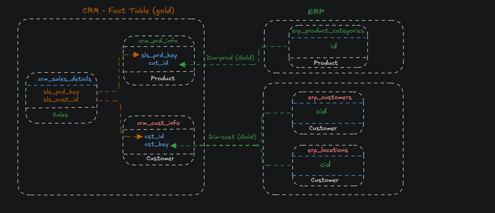
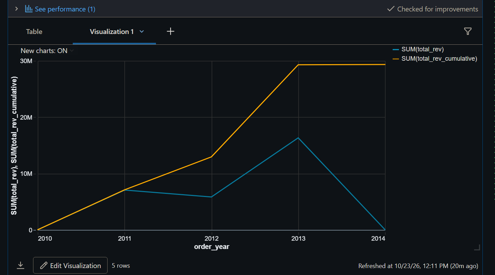
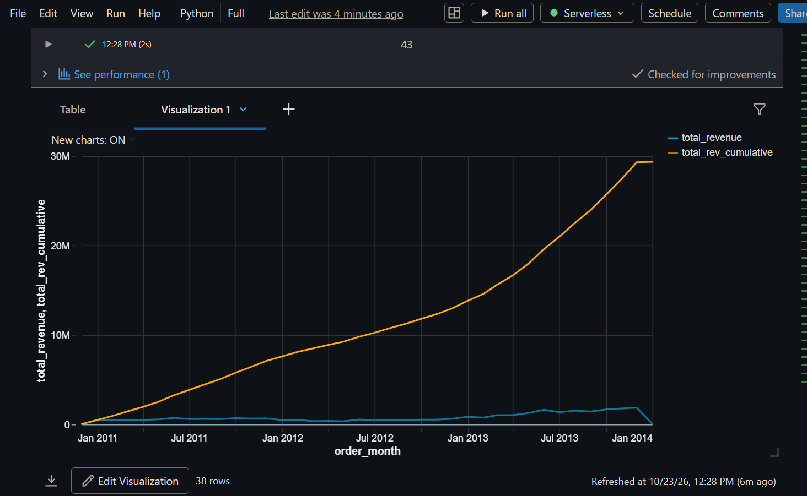

# Medallion Architecture (Bronze / Silver / Gold) in Databricks

## 1. Project Overview

This project implements a Medallion Data Architecture in Databricks using dbt. The goal is to ingest raw CRM and ERP data, rigorously clean and standardize it in the Silver layer, and build a unified analytical Star Schema in the Gold layer.

- **Source Systems:** CRM, ERP
- **Tools:** Databricks (Spark SQL), dbt
- **Architecture:** Bronze (Raw) -> Silver (Cleaned) -> Gold (Business Ready)

### 🗺️ Data Architecture & Lineage
The following diagram illustrates the complete data flow, including source systems, Bronze ingestion, Silver standardization, and the final Gold Star Schema.


### 💡 Tech Stack & Architecture Choices

- **OLTP vs. OLAP:** The reference tutorial uses **SQL Server** (OLTP), optimized for transactions and raw data. This project uses **Databricks** (OLAP), optimized for analytics and aggregations.
- **dbt vs. Traditional T-SQL:** In the traditional SQL Server tutorial, explicit `CREATE TABLE` statements and Stored Procedures (`CREATE OR ALTER PROCEDURE`) with `TRY...CATCH` and `TRUNCATE/INSERT` are used. In this project using dbt, **manual DDL is not needed**. dbt acts as the orchestrator, automatically resolving dependencies via `{{ ref() }}`, managing materializations (Table/View), and building a DAG.

---

## 2. Data Profiling & Validation (Pre & Post-Cleaning Checks)

Before and after applying transformations, the data is profiled to identify anomalies.

### A. Check for Unwanted Spaces (`TRIM`)
```sql
SELECT prd_key, prd_nm
FROM crm_dbt_dev.bronze.bronze_crm_prd
WHERE prd_key != TRIM(prd_key) OR prd_nm != TRIM(prd_nm);
```

### B. Check for Duplicates (`HAVING COUNT > 1`)
```sql
SELECT prd_id, prd_key, COUNT(*) as duplicate_count
FROM crm_dbt_dev.bronze.bronze_crm_prd
GROUP BY prd_id, prd_key
HAVING COUNT(*) > 1;
```

### C. Check for Out-of-Range Dates (Birthdates)
```sql
SELECT DISTINCT bdate
FROM crm_dbt_dev.bronze.bronze_erp_cust_az12
WHERE bdate < '1924-01-01' OR bdate > current_date();
```

### D. Post-Cleaning Validations (on Silver Tables)
```sql
-- 1. Data Standardization (Product Line)
SELECT DISTINCT prd_line FROM crm_dbt_dev.silver.silver_crm_prd_info;

-- 2. Invalid Date Orders (SCD Overlap Check)
SELECT * FROM crm_dbt_dev.silver.silver_crm_prd_info WHERE prd_end_dt < prd_start_dt;

-- 3. Business Rules (Sales Amount Integrity)
SELECT * FROM crm_dbt_dev.silver.silver_crm_sales_details
WHERE sls_sales != sls_quantity * sls_price
   OR sls_sales IS NULL OR sls_quantity IS NULL OR sls_price IS NULL
   OR sls_sales <= 0 OR sls_price <= 0;
```

---

## 3. Data Cleaning Logic & Core Code (Silver Layer)

### A. Customer Tables (CRM + ERP)

#### ERP (`silver_erp_cust_az12.sql`)
```sql
{{ config(materialized='table', schema='silver', alias='erp_customers') }}
with
    source_data as (select * from {{ source('bronze_source', 'bronze_erp_cust_az12') }})
select
    -- Cleaning Strategy: String Manipulation (Remove 'NAS' prefix)
    case when cid like 'NAS%' then substring(cid, 4) else cid end as cid,
    -- Cleaning Strategy: Business Rule (Filter out impossible birthdates)
    case when bdate < '1924-01-01' or bdate > current_date() then null else bdate end as bdate,
    -- Cleaning Strategy: Standardization (Map abbreviations to full words)
    case 
        when upper(trim(gen)) in ('M', 'MALE') then 'Male'
        when upper(trim(gen)) in ('F', 'FEMALE') then 'Female'
        else 'n/a'
    end as gen,
    current_timestamp() as dwh_create_date
from source_data;
```

#### CRM (`silver_crm_cust_info.sql`)
```sql
{{ config(materialized='table', schema='silver', alias='crm_cust_info') }}
with
    source_data as (select * from {{ source('bronze_source', 'bronze_crm_cust') }}),
    filtered_data as (select * from source_data where cst_id is not null),
    deduplicated as (
        -- Cleaning Strategy: Deduplication (Keep the latest record per customer)
        select *, row_number() over (partition by cst_id order by cst_create_date desc) as rn
        from filtered_data
    )
select
    cst_id,
    trim(cst_key) as cst_key,
    trim(cst_firstname) as cst_firstname,
    trim(cst_lastname) as cst_lastname,
    case
        when upper(trim(cst_marital_status)) = 'M' then 'Married'
        when upper(trim(cst_marital_status)) = 'S' then 'Single'
        else 'n/a'
    end as cst_marital_status,
    case
        when upper(trim(cst_gndr)) = 'M' then 'Male'
        when upper(trim(cst_gndr)) = 'F' then 'Female'
        else 'n/a'
    end as cst_gndr,
    current_timestamp() as dwh_create_date
from deduplicated
where rn = 1;
```

#### ERP (`silver_erp_loc_a101.sql`)
```sql
{{ config(materialized='table', schema='silver', alias='erp_locations') }}
with
    source_data as (select * from {{ source('bronze_source', 'bronze_erp_loc_a101') }})
select
    -- Cleaning Strategy: String Manipulation (Remove hyphens)
    replace(trim(cid), '-', '') as cid,
    -- Cleaning Strategy: Standardization (Unify country names)
    case 
        when upper(trim(cntry)) in ('US', 'USA', 'UNITED STATES') then 'United States'
        when upper(trim(cntry)) in ('DE', 'GERMANY') then 'Germany'
        when upper(trim(cntry)) = 'AUSTRALIA' then 'Australia'
        when upper(trim(cntry)) = 'CANADA' then 'Canada'
        when upper(trim(cntry)) = 'UNITED KINGDOM' then 'United Kingdom'
        when upper(trim(cntry)) = 'FRANCE' then 'France'
        when trim(cntry) = '' or cntry is null then 'n/a'
        else upper(trim(cntry))
    end as cntry,
    current_timestamp() as dwh_create_date
from source_data;
```

### B. Product Tables (CRM + ERP)

#### CRM (`silver_crm_prd_info.sql`)
This model handles SCD Type 2 logic, fixing overlapping dates without losing history.

```sql
{{ config(materialized='table', schema='silver', alias='crm_prd_info') }}
with
    source_data as (select * from {{ source('bronze_source', 'bronze_crm_prd') }}),
    step1_base as (
        select
            prd_id,
            trim(prd_key) as prd_key,
            trim(prd_nm) as prd_nm,
            coalesce(prd_cost, 0) as prd_cost,
            case
                upper(trim(prd_line))
                when 'M' then 'Mountain'
                when 'R' then 'Road'
                when 'S' then 'Other Sales'
                when 'T' then 'Touring'
                else 'n/a'
            end as prd_line,
            -- Cleaning Strategy: String Manipulation (Extract category ID and sales key)
            replace(substring(prd_key, 1, 5), '-', '_') as cat_id,
            substring(trim(prd_key), 7) as sls_prd_key,
            prd_start_dt as orig_start_dt,
            prd_end_dt as orig_end_dt,
            prd_start_dt as fixed_start_dt,
            current_timestamp() as dwh_create_date
        from source_data
    ),
    step2_rebuild_timeline as (
        select
            prd_id, prd_key, prd_nm, prd_cost, prd_line, cat_id, sls_prd_key,
            orig_start_dt, orig_end_dt, dwh_create_date,
            fixed_start_dt as prd_start_dt,
            -- Cleaning Strategy: SCD Type 2 Timeline Repair (Use LEAD to fix overlaps)
            case
                when lead(fixed_start_dt) over (partition by prd_key order by fixed_start_dt, prd_id) is not null
                then date_sub(lead(fixed_start_dt) over (partition by prd_key order by fixed_start_dt, prd_id), 1)
                else null
            end as prd_end_dt
        from step1_base
    )
select * from step2_rebuild_timeline;
```

**Result Validation:**
The following image shows the successful execution in Databricks. You can clearly see how the overlapping historical dates (`orig_start_dt` / `orig_end_dt`) have been perfectly aligned into a clean timeline (`prd_start_dt` / `prd_end_dt`) without any gaps or overlaps.


#### ERP (`silver_erp_px_cat_g1v2.sql`)
```sql
{{ config(materialized='table', schema='silver', alias='erp_product_categories') }}
with
    source_data as (select * from {{ source('bronze_source', 'bronze_erp_px_cat_g1v2') }})
select
    trim(id) as id,
    trim(cat) as cat,
    trim(subcat) as subcat,
    trim(maintenance) as maintenance,
    current_timestamp() as dwh_create_date
from source_data;
```

### C. Sales Table (`silver_crm_sales_details.sql`)
```sql
{{ config(materialized='table', schema='silver', alias='crm_sales_details') }}
with
    source_data as (select * from {{ source('bronze_source', 'bronze_crm_sales_details') }}),
    filtered_data as (select * from source_data where sls_ord_num is not null),
    cleaned_data as (
        select
            trim(sls_ord_num) as sls_ord_num,
            trim(sls_prd_key) as sls_prd_key,
            sls_cust_id,
            -- Cleaning Strategy: Date parsing with length validation
            case when sls_order_dt = 0 or length(cast(sls_order_dt as string)) != 8 then null else to_date(cast(sls_order_dt as string), 'yyyyMMdd') end as sls_order_dt,
            case when sls_ship_dt = 0 or length(cast(sls_ship_dt as string)) != 8 then null else to_date(cast(sls_ship_dt as string), 'yyyyMMdd') end as sls_ship_dt,
            case when sls_due_dt = 0 or length(cast(sls_due_dt as string)) != 8 then null else to_date(cast(sls_due_dt as string), 'yyyyMMdd') end as sls_due_dt,
            -- Cleaning Strategy: Business Rule (Recalculate invalid sales amounts)
            case
                when sls_sales is null or sls_sales <= 0 or sls_sales != sls_quantity * abs(sls_price) 
                then sls_quantity * abs(sls_price)
                else sls_sales
            end as sls_sales,
            sls_quantity,
            case
                when sls_price is null or sls_price <= 0 
                then sls_sales / nullif(sls_quantity, 0)
                else sls_price
            end as sls_price,
            current_timestamp() as dwh_create_date
        from filtered_data
    )
select * from cleaned_data;
```

---

## 4. Gold Layer: Star Schema & Architecture

### 🏗️ Architecture Choice: Star Schema vs. OBT (One Big Table)
A common question is: *Why not just join everything into one giant flat table (OBT) at the Silver layer?*
While OBTs are simple for one-off queries, this project implements a **Star Schema (Fact + Dimensions)** for the following enterprise-grade reasons:
1. **Decoupling:** Dimensions (Customers, Products) are decoupled from the Fact table. If a customer changes their address, we only update one row in `dim_customers`, rather than rewriting millions of historical sales records in an OBT.
2. **Storage Efficiency:** An OBT duplicates customer names and product names for every single sales transaction. A Star Schema stores dimension attributes only once.
3. **BI Performance:** Modern BI tools (Tableau, PowerBI) are optimized for Star Schemas. They cache dimensions and use Surrogate Keys to perform lightning-fast joins.

### ⚙️ Execution Order: Dims First, Fact Last
Because the Fact table depends on the Surrogate Keys (`customer_key`, `product_key`) generated in the Dimension tables, the **execution order is strictly: Dimensions -> Fact**.
In dbt, this is automatically handled by the DAG when using `{{ ref() }}`. When running manually, use:
```bash
# Step 1: Build Dimensions
dbt run --select dim_customers dim_products
# Step 2: Build Fact
dbt run --select fct_sales
```

### 🔗 Gold Join Relationship
The following diagram illustrates how the Fact table joins with the Dimension tables using Surrogate Keys and Business Keys.



### A. Dimensions (`dim_customers` & `dim_products`)

#### `dim_customers.sql`
```sql
{{ config(materialized='table', schema='gold') }}

select
    -- Generate Surrogate Key
    row_number() over (order by c.cst_id) as customer_key,
    
    -- Business Keys
    c.cst_id as customer_id,
    c.cst_key,
    
    -- Descriptive columns
    c.cst_firstname,
    c.cst_lastname,
    c.cst_marital_status,
    
    -- Trust CRM as the primary source, fallback to ERP if CRM is null or 'n/a'
    case 
        when c.cst_gndr is not null and c.cst_gndr != 'n/a' then c.cst_gndr
        else coalesce(e.gen, 'n/a')
    end as gender,
    
    e.bdate as birthdate,
    l.cntry as country,
    c.dwh_create_date
from {{ ref('crm_cust_info') }} c
left join {{ ref('erp_customers') }} e on c.cst_key = e.cid
left join {{ ref('erp_locations') }} l on c.cst_key = l.cid;
```

#### `dim_products.sql`
```sql
{{ config(materialized='table', schema='gold') }}

select
    -- Generate Surrogate Key
    row_number() over (order by p.prd_id, p.prd_start_dt) as product_key,
    
    -- Business Keys
    p.prd_id,
    p.prd_key,
    p.sls_prd_key,
    
    -- Descriptive columns
    p.prd_nm,
    p.prd_cost,
    p.prd_line,
    p.cat_id,
    c.cat as category_name,
    c.subcat as subcategory_name,
    p.dwh_create_date
from {{ ref('crm_prd_info') }} p
left join {{ ref('erp_product_categories') }} c on p.cat_id = c.id
-- Only keep the current active product state to prevent fan-out
where p.prd_end_dt is null;
```

### B. Fact Table (`fct_sales.sql`)
```sql
{{ config(materialized='table', schema='gold') }}

select
    -- Fact Metrics
    s.sls_ord_num,
    s.sls_order_dt,
    s.sls_ship_dt,
    s.sls_due_dt,
    s.sls_sales,
    s.sls_quantity,
    s.sls_price,

    -- Surrogate Keys from Dimensions
    c.customer_key,
    p.product_key,

    -- Descriptive columns (for easy BI querying)
    c.cst_firstname,
    c.cst_lastname,
    c.country,
    p.prd_nm,
    p.category_name,
    p.subcategory_name,

    -- Audit timestamp
    s.dwh_create_date
from {{ ref('crm_sales_details') }} s
left join {{ ref('dim_customers') }} c on s.sls_cust_id = c.customer_id
left join {{ ref('dim_products') }} p on s.sls_prd_key = p.sls_prd_key;
```

---

## 5. dbt Project Structure & Tests

### A. Directory Structure
```text
crm_dbt/
├── assets/
│   ├── data_flow.png
│   ├── cleaned crm prod.png
│   └── gold_join_relation.png
├── crm_dbt_in/
│   ├── models/
│   │   ├── bronze/
│   │   │   └── sources.yml
│   │   ├── silver/
│   │   │   ├── schema.yml
│   │   │   ├── silver_crm_cust_info.sql
│   │   │   ├── silver_erp_cust_az12.sql
│   │   │   ├── silver_erp_loc_a101.sql
│   │   │   ├── silver_crm_prd_info.sql
│   │   │   ├── silver_erp_px_cat_g1v2.sql
│   │   │   └── silver_crm_sales_details.sql
│   │   └── gold/
│   │       ├── schema.yml
│   │       ├── dim_customers.sql
│   │       ├── dim_products.sql
│   │       └── fct_sales.sql
│   ├── dbt_project.yml
│   └── packages.yml
└── README.md
```

### B. Data Tests & Validation Results (`models/gold/schema.yml`)
Implemented **12 automated tests** to ensure industrial-grade data quality. All tests passed successfully (`PASS=12`).

Furthermore, a rigorous **Fan-out (Data Explosion) Validation** was performed on the Gold layer to ensure zero data duplication and 100% referential integrity.

**Validation SQL:**
```sql
SELECT 
    (SELECT COUNT(*) FROM crm_dbt_dev.gold.fct_sales) AS original_fact_rows,
    (SELECT COUNT(*) FROM crm_dbt_dev.gold.fct_sales f LEFT JOIN crm_dbt_dev.gold.dim_customers c ON f.customer_key = c.customer_key) AS after_customer_join,
    (SELECT COUNT(*) FROM crm_dbt_dev.gold.fct_sales f LEFT JOIN crm_dbt_dev.gold.dim_products p ON f.product_key = p.product_key) AS after_product_join;
```

**Validation Results:**
- **Original Fact Rows:** 60,398
- **Rows after `LEFT JOIN dim_customers`:** 60,398
- **Rows after `LEFT JOIN dim_products`:** 60,398

This confirms that:
1. **No Orphaned Records:** Every transaction has a valid customer and product.
2. **No Fan-out:** The Surrogate Keys in the dimension tables are strictly unique, ensuring sales metrics are accurate and never double-counted.

*(The following dbt tests enforce this integrity automatically on every run)*
```yaml
version: 2

models:
  - name: dim_customers
    description: "Customer dimension table merging CRM and ERP data"
    columns:
      - name: customer_key
        tests:
          - unique
          - not_null
      - name: customer_id
        tests:
          - unique
          - not_null

  - name: dim_products
    description: "Product dimension table merging CRM and ERP category data"
    columns:
      - name: product_key
        tests:
          - unique
          - not_null
      - name: prd_key
        tests:
          - unique
          - not_null

  - name: fct_sales
    description: "Sales fact table containing transactional data"
    columns:
      - name: sls_ord_num
        tests:
          - not_null
      - name: sls_sales
        tests:
          - not_null
      - name: customer_key
        tests:
          - relationships:
              to: ref('dim_customers')
              field: customer_key
      - name: product_key
        tests:
          - relationships:
              to: ref('dim_products')
              field: product_key
```

---

## 6. How to Run

1. Install dbt packages:
   ```bash
   dbt deps
   ```
2. Run all models (Silver and Gold):
   ```bash
   dbt run
   ```
3. Run data quality tests:
   ```bash
   dbt test
   ```

---

## 🏛️ Design Decision: Why `fct_sales` Excludes Descriptive Attributes (Strict Dimensional Modeling)

A critical architectural decision in the Gold layer was to strictly exclude descriptive attributes (e.g., `country`, `product_name`, `category_name`) from the `fct_sales` fact table. The fact table contains **only** Surrogate Keys (`customer_key`, `product_key`) and business metrics (`sls_sales`, `sls_quantity`). 

This is not a stylistic choice; it is a mandatory rule to prevent **data inconsistency and report clashes**, especially when dimensions have historical tracking (**SCD Type 2**).

### ⚠️ The Problem: Redundancy Causes "Report Clashes"
If we redundantly store a customer's `country` in the fact table, updating the dimension creates a severe discrepancy between historical and current states.

**Scenario:** 
*   A customer named John bought products in 2023 while living in the **US**. 
*   In 2024, John moves to **Canada**. 
*   We have a `dim_customers` table with **SCD Type 2** enabled. The old US record is marked as expired (`dbt_valid_to = '2024-01-01'`), and a new Canada record is created (`dbt_valid_to = NULL`).

**What happens if we redundantly store `country` in `fct_sales`?**
1.  **Aggregating the Fact Table (As-Is):** If you query the fact table's `country` column, the 2023 sales are attributed to the **US**. The 2024 sales are attributed to **Canada**. This is historically correct (As-Is).
2.  **Aggregating via Dimension Join (As-Was):** If you `LEFT JOIN dim_customers` using the *current* active record (`dbt_valid_to IS NULL`), all historical 2023 sales suddenly shift from the US to **Canada**. 
3.  **The Clash:** Two different queries produce two different revenue numbers for the same country. The CEO sees one number, the Finance team sees another, and the Data Team gets blamed.

### ✅ The Solution: Single Source of Truth (SSoT)
By keeping the fact table clean and storing only `customer_key`, we force analysts to explicitly define their business logic via `LEFT JOIN` at query time. 

This also works perfectly with **SCD Type 2 snapshots**. If an analyst wants to see sales based on the customer's *current* country, they join on the active dimension record. If they want *historical* accuracy (As-Is), they can join using the surrogate key generated by the snapshot table (`dbt_scd_id`), which perfectly aligns with the exact historical version.

### 💻 Code Examples: How to Query the Clean Star Schema

**Standard Join (Current State / As-Was):**
```sql
-- Business Question: How much revenue does each country generate NOW?
SELECT 
    dc.country, 
    SUM(fs.sls_sales) AS total_revenue
FROM crm_dbt_dev.gold.fct_sales fs
LEFT JOIN crm_dbt_dev.gold.dim_customers dc 
    ON fs.customer_key = dc.customer_key
WHERE dc.dbt_valid_to IS NULL -- Only join the current active record
GROUP BY dc.country
ORDER BY total_revenue DESC;
```

---

## 7. Key Takeaways & Core Cleaning Strategies

This project demonstrates several core enterprise data cleaning and architectural strategies used to transform raw, messy data into a reliable Star Schema:

1. **Data Profiling & Duplicate Detection (`HAVING COUNT > 1`):** Before cleaning, data is profiled to identify duplicated primary keys and anomalies. In the Silver layer, deduplication is handled using `ROW_NUMBER()` to retain only the most recent record.
2. **String Manipulation & Key Extraction (`REPLACE`, `SUBSTRING`):** Cross-system keys rarely match. We used `REPLACE` to strip prefixes (e.g., removing 'NAS' from ERP IDs) and `SUBSTRING` to extract specific business keys (e.g., splitting `prd_key` into `cat_id` and `sls_prd_key`).
3. **Standardization (`CASE WHEN`):** Inconsistent categorical data (e.g., 'M' vs 'Male', 'US' vs 'USA') is standardized into unified, readable formats using `CASE WHEN` statements.
4. **SCD Type 2 Timeline Repair (`LEAD` & `DATE_SUB`):** To fix overlapping historical product dates, window functions (`LEAD`) are used to dynamically set a record's end date to exactly 1 day before the next record's start date, ensuring a clean, gap-free timeline.
5. **Defensive Programming:** Used `NULLIF(column, 0)` to prevent `Divide by Zero` errors. Handled extreme out-of-range dates (e.g., `9999-11-20`) by setting them to `NULL`.
6. **Strict Dimensional Modeling (No Redundant Attributes):** The `fct_sales` table strictly stores only Surrogate Keys and Metrics. Descriptive attributes are excluded to prevent data inconsistency when dimension attributes change. This enforces a Single Source of Truth (SSoT).

### 🏆 Enterprise Architecture Highlights:
- **Surrogate Keys in Star Schema:** Generated surrogate keys using `ROW_NUMBER()` in the Gold layer dimensions to decouple the data warehouse from source system business keys, ensuring stable and high-performance joins.
- **Preventing Fan-out:** Filtered `dim_products` using `WHERE prd_end_dt IS NULL` to ensure the dimension table only exposes the current active version of each product, preventing duplicate sales records during the fact table join.
- **Automated Data Quality:** Leveraged dbt's `relationships` test to enforce referential integrity between the fact and dimension tables, ensuring zero orphaned records.

---

## 8. Business Value & Ad-hoc Analysis

To demonstrate that the Gold layer is not just a technical artifact but a business-ready asset, the following **Ad-hoc Analyses** were performed. Note how the clean fact table (containing only Surrogate Keys and Metrics) is seamlessly joined with dimension tables to answer specific business questions.

### 📊 1. Executive KPI Summary
This query uses `UNION ALL` to pivot multiple business metrics into a single, unpivoted report format—a common requirement for executive dashboards.

```sql
-- Generate a Report that shows all key metrics of the business
SELECT 'Total Sales' AS measure_name, SUM(sls_sales) AS measure_value 
FROM crm_dbt_dev.gold.fct_sales

UNION ALL
SELECT 'Total Quantity', SUM(sls_quantity) 
FROM crm_dbt_dev.gold.fct_sales

UNION ALL
SELECT 'Average Price', ROUND(AVG(sls_price), 2) 
FROM crm_dbt_dev.gold.fct_sales

UNION ALL
SELECT 'Total Nr. Orders', COUNT(DISTINCT sls_ord_num) 
FROM crm_dbt_dev.gold.fct_sales

UNION ALL
SELECT 'Total Nr. Products', COUNT(DISTINCT product_key) 
FROM crm_dbt_dev.gold.dim_products

UNION ALL
SELECT 'Total Nr. Customers', COUNT(DISTINCT customer_key) 
FROM crm_dbt_dev.gold.dim_customers;
```

### 🏆 2. Top 5 Products by Revenue
**Business Question:** *Which products are generating the most revenue?*

```sql
SELECT 
    dp.prd_nm, 
    SUM(fs.sls_sales) AS total_revenue
FROM crm_dbt_dev.gold.fct_sales fs
LEFT JOIN crm_dbt_dev.gold.dim_products dp
    ON fs.product_key = dp.product_key
GROUP BY dp.prd_nm
ORDER BY total_revenue DESC
LIMIT 5;
```

### 👑 3. Top 10 Customers by Lifetime Value (LTV)
**Business Question:** *Who are our most valuable customers, and how much have they contributed to our revenue?*

```sql
SELECT 
    c.customer_id, 
    c.cst_firstname, 
    c.cst_lastname, 
    SUM(fs.sls_sales) AS total_lifetime_value
FROM crm_dbt_dev.gold.fct_sales fs
LEFT JOIN crm_dbt_dev.gold.dim_customers c
    ON fs.customer_key = c.customer_key
GROUP BY 
    c.customer_id, 
    c.cst_firstname, 
    c.cst_lastname
ORDER BY total_lifetime_value DESC
LIMIT 10;
```

### 🌍 4. Sales Volume by Country
**Business Question:** *Which countries are driving the highest sales volume?*

```sql
SELECT 
    dc.country, 
    SUM(fs.sls_quantity) AS total_quantity
FROM crm_dbt_dev.gold.fct_sales fs
LEFT JOIN crm_dbt_dev.gold.dim_customers dc 
    ON fs.customer_key = dc.customer_key
GROUP BY dc.country
ORDER BY total_quantity DESC;
```

### 📉 5. Customers with the Fewest Orders (Churn Risk)
**Business Question:** *Which customers have placed the fewest orders?*

While finding the highest-value customers is crucial for retention, identifying customers with very low order frequencies is equally important for **re-engagement and churn-prevention campaigns**. 

```sql
SELECT 
    c.customer_id, 
    c.cst_firstname, 
    c.cst_lastname, 
    COUNT(DISTINCT fs.sls_ord_num) AS total_orders
FROM crm_dbt_dev.gold.fct_sales fs
LEFT JOIN crm_dbt_dev.gold.dim_customers c
    ON fs.customer_key = c.customer_key
WHERE fs.sls_ord_num IS NOT NULL -- Exclude customers with zero valid transactions
GROUP BY 
    c.customer_id, 
    c.cst_firstname, 
    c.cst_lastname
ORDER BY total_orders ASC -- From fewest to most
LIMIT 10;
```

### 💡 Engineering & Business Value Notes:
- **Demonstrating the Star Schema:** All descriptive analyses above (`prd_nm`, `country`, `cst_firstname`) require joining the clean fact table with dimension tables. This proves the architectural decision to exclude redundant attributes from `fct_sales` was correct—it forces a Single Source of Truth (SSoT) and prevents data inconsistency.
- **`LIMIT` vs. `RANK()`:** For dashboarding, `ORDER BY ... LIMIT N` is the most efficient way to get top results. However, in production scenarios where ties at the Nth position matter (e.g., awarding bonuses), using window functions like `RANK() OVER (ORDER BY total_revenue DESC) <= 5` is more business-accurate, as it includes all tied records.
- **Handling Orphaned Records & Churn Risk:** Because we use `LEFT JOIN`, any transaction without a matching dimension record will result in a `NULL` grouping. For churn risk analysis, sorting ascending (`ASC`) helps the marketing team identify low-frequency buyers for re-engagement campaigns.
- **SQL Best Practice:** While `GROUP BY 1, 2, 3` is valid, production-level dbt models should use explicit column names to prevent bugs if the `SELECT` order changes. 


### 📅 6. Yearly Business Performance & YoY Growth
**Business Question:** *How is our business performing year over year in terms of revenue, active customers, and volume, and what is the growth rate?*

To get a comprehensive view of the business trajectory, we aggregate core KPIs per year and use the `LAG()` window function to calculate Year-over-Year (YoY) revenue growth:

```sql
WITH yearly_sales AS (
    SELECT 
        YEAR(sls_order_dt) AS order_year, 
        SUM(sls_sales) AS total_revenue,
        COUNT(DISTINCT customer_key) AS total_active_customers,
        SUM(sls_quantity) AS total_quantity
    FROM crm_dbt_dev.gold.fct_sales
    WHERE sls_order_dt IS NOT NULL
    GROUP BY YEAR(sls_order_dt)
)
SELECT 
    order_year,
    total_revenue,
    total_active_customers,
    total_quantity,
    -- Calculate Year-over-Year (YoY) Revenue Growth
    LAG(total_revenue) OVER (ORDER BY order_year) AS prev_year_revenue,
    ROUND(
        (total_revenue - LAG(total_revenue) OVER (ORDER BY order_year)) 
        / LAG(total_revenue) OVER (ORDER BY order_year) * 100, 
    2) AS yoy_growth_pct
FROM yearly_sales
ORDER BY order_year ASC;
```

**💡 Engineering & Business Notes:**
- **The Power of `COUNT(DISTINCT ...)`:** Because our fact table is at the line-item grain (one order can contain multiple products), we must use `COUNT(DISTINCT customer_key)` to find the true number of *unique* active customers per year. A simple `COUNT` would overcount if a customer made multiple purchases in the same year.
- **`LAG()` for YoY Growth:** `LAG(total_revenue)` allows us to look back at the previous year's revenue without writing a self-join. This is a standard analytics engineering pattern for time-series comparisons.
- **Handling Null Dates:** The `WHERE sls_order_dt IS NOT NULL` clause filters out orphaned records (corrupted dates set to `NULL` during cleaning). This prevents the time-series chart from breaking.
- **Business Insight:** This query immediately exposes the explosive growth in **2013 (+131% YoY)** and the sharp drop in **2014**, which is highly likely due to incomplete data ingestion for that year rather than a real business collapse—a key insight for data quality monitoring.

### 📅 7. Seasonality Analysis: Monthly Sales Trends
**Business Question:** *Which months have the highest (and lowest) sales performance across the years?*

To analyze seasonality (e.g., holiday peaks in December vs. slow months in February), we extract the month and aggregate the metrics. 

```sql
SELECT 
    MONTH(sls_order_dt) AS order_month, 
    SUM(sls_sales) AS total_revenue,
    COUNT(DISTINCT customer_key) AS total_active_customers,
    SUM(sls_quantity) AS total_quantity
FROM crm_dbt_dev.gold.fct_sales
WHERE sls_order_dt IS NOT NULL
GROUP BY MONTH(sls_order_dt)
ORDER BY total_revenue DESC;
```

**💡 Engineering & Business Notes:**
- **The Pitfall of `MONTH()` Without `YEAR()`:** In the query above, data from December 2010, December 2011, and December 2013 are all grouped into a single `order_month = 12`. While this is useful for a high-level seasonal overview, it combines multiple years of data. 
- **Advanced Seasonality (Best Practice):** For a rigorous time-series analysis, you must group by both `YEAR()` and `MONTH()` to observe the specific trend of each month across each year.

```sql
-- Advanced: Monthly trend across specific years
SELECT 
    YEAR(sls_order_dt) AS order_year,
    MONTH(sls_order_dt) AS order_month,
    SUM(sls_sales) AS total_revenue
FROM crm_dbt_dev.gold.fct_sales
WHERE sls_order_dt IS NOT NULL
GROUP BY YEAR(sls_order_dt), MONTH(sls_order_dt)
ORDER BY order_year ASC, order_month ASC;
```

- **Business Insight:** By running the first query, we can immediately see that **December is our peak revenue month** (likely driven by holiday shopping), while **February is the slowest month**. The marketing team can use this insight to allocate budget more effectively—aggressively scaling up ads in November/December, and launching retention/promotion campaigns in January/February to offset the post-holiday slump.

### 📈 8. Yearly Cumulative Business Growth (Running Totals)
**Business Question:** *How has our total revenue accumulated over the years?*

To understand the macro trajectory of the business, we use a window function to calculate the running total of revenue by year. This creates a "Hockey Stick" curve that clearly highlights periods of explosive growth.

```sql
WITH yearly_metrics AS (
    SELECT 
        YEAR(sls_order_dt) AS order_year, 
        SUM(sls_sales) AS total_revenue
    FROM crm_dbt_dev.gold.fct_sales
    WHERE sls_order_dt IS NOT NULL
    GROUP BY YEAR(sls_order_dt)
)
SELECT 
    order_year, 
    total_revenue, 
    SUM(total_revenue) OVER (ORDER BY order_year) AS cumulative_revenue
FROM yearly_metrics
ORDER BY order_year ASC;
```

**📊 Visualization & Business Insights:**


- **The "Hockey Stick" Growth:** The chart reveals a massive revenue jump in 2013, causing the cumulative line to steepen dramatically. This indicates the business found a highly successful scaling strategy that year.
- **Data Quality Detection:** Notice how the blue line (annual revenue) drops to near zero in 2014, causing the orange cumulative line to flatline. This visual anomaly instantly alerts us to the fact that **the 2014 dataset is incomplete**, preventing stakeholders from misinterpreting missing data as a business collapse.

### 📅 9. Monthly Cumulative Business Growth (High-Resolution)
**Business Question:** *How has our revenue accumulated month-over-month, and when exactly did our growth accelerate?*

By using `date_trunc('month', sls_order_dt)`, we preserve the `DATE` data type (e.g., `2013-05-01`). This ensures BI tools can natively render a continuous time-series axis without manual string concatenation.

```sql
WITH monthly_sales AS (
    SELECT 
        date_trunc('month', sls_order_dt) AS order_month,
        SUM(sls_sales) AS total_revenue
    FROM crm_dbt_dev.gold.fct_sales
    WHERE sls_order_dt IS NOT NULL
    GROUP BY date_trunc('month', sls_order_dt)
)
SELECT 
    order_month,
    total_revenue, 
    SUM(total_revenue) OVER (ORDER BY order_month) AS total_rev_cumulative 
FROM monthly_sales
ORDER BY order_month ASC;
```

**📊 Visualization & Business Insights:**


- **Granularity Alignment:** The `GROUP BY` establishes the month-level grain, and the `OVER (ORDER BY order_month)` perfectly mirrors it. This guarantees the running total increments smoothly without skipping months.
- **Operational Focus:** The monthly cumulative chart provides a high-resolution timeline. It allows operations teams to pinpoint the exact months in 2013 where the business shifted from linear growth to exponential growth, making it easier to tie specific marketing campaigns or product launches to revenue spikes.

### 💡 Engineering Note: The "Weighting Trap" in Moving Averages

While exploring different analytical approaches, I identified a critical mathematical flaw in a common tutorial pattern (seen in the reference tutorial at [Video #12, ~22:00](https://www.youtube.com/watch?v=2jGhQpbzHes&list=PLNcg_FV9n7qaUWeyUkPfiVtMbKlrfMqA8&index=12)): calculating a "moving average" using `AVG(AVG(price)) OVER (ORDER BY year)`. 

- **The Flaw (Average of Averages):** This approach calculates the unweighted average of yearly average prices. If Year 1 sells 1 luxury item for $500,000, and Year 2 sells 10,000 economy items for $50,000, this formula yields **$275,000**. It completely ignores the sales volume, severely distorting the business reality.
- **The Correct Approach (Weighted Moving Average):** A true moving average must be volume-weighted. It requires calculating `SUM(total_revenue) / SUM(total_quantity)` over a sliding window (e.g., `ROWS BETWEEN 2 PRECEDING AND CURRENT ROW`). This yields a statistically sound result of **~$54,900**, reflecting true customer behavior.

By identifying and correcting this "average of averages" trap, I ensured that all business KPIs in this project remain statistically sound and volume-weighted.


### 📊 10. Product-Level YoY Performance & Historical Comparison
**Business Question:** *For each product, how does its current year's sales compare to its previous year, its historical average, and is it overperforming or underperforming?*

This query uses a CTE to establish the `(Year, Product)` grain, then applies window functions to calculate YoY growth, historical baseline, variance, and a dynamic performance flag.

```sql
WITH product_yearly_sales AS (
    SELECT 
        YEAR(fs.sls_order_dt) AS order_year,
        dp.prd_nm,
        SUM(fs.sls_sales) AS current_year_sales
    FROM crm_dbt_dev.gold.fct_sales fs
    LEFT JOIN crm_dbt_dev.gold.dim_products dp 
        ON fs.product_key = dp.product_key
    WHERE fs.sls_order_dt IS NOT NULL
    GROUP BY YEAR(fs.sls_order_dt), dp.prd_nm
),
comparison_cte AS (
    SELECT 
        order_year,
        prd_nm,
        current_year_sales,
        AVG(current_year_sales) OVER (PARTITION BY prd_nm) AS avg_historical_sales,
        LAG(current_year_sales) OVER (PARTITION BY prd_nm ORDER BY order_year) AS prev_year_sales
    FROM product_yearly_sales
)
SELECT 
    order_year,
    prd_nm,
    current_year_sales,
    ROUND(avg_historical_sales, 2) AS avg_sales,
    ROUND(current_year_sales - avg_historical_sales, 2) AS diff_avg,
    prev_year_sales,
    ROUND(current_year_sales - prev_year_sales, 2) AS diff_prev_year,
    
    -- 1. Compared to Historical Average
    CASE 
        WHEN current_year_sales > avg_historical_sales THEN 'Above Avg'
        WHEN current_year_sales < avg_historical_sales THEN 'Below Avg'
        ELSE 'At Avg'
    END AS avg_change_flag,
    
    -- 2. Compared to Previous Year (Handling the first year explicitly)
    CASE 
        WHEN prev_year_sales IS NULL THEN 'No Baseline'
        WHEN current_year_sales > prev_year_sales THEN 'Increase'
        WHEN current_year_sales < prev_year_sales THEN 'Decrease'
        ELSE 'No Change'
    END AS py_change_flag
        
FROM comparison_cte
ORDER BY prd_nm, order_year ASC;
```

**💡 Engineering & Business Value Notes:**
- **Explicit Edge Case Handling:** The first year of a product's lifecycle (`prev_year_sales IS NULL`) is explicitly flagged as `'No Baseline'` rather than `'No Change'`. This preserves the semantic difference between "unknown year-over-year performance" and "zero year-over-year growth". 
- **BI Flexibility:** By outputting `avg_change_flag` and `py_change_flag` as separate columns, analysts can dynamically slice the data (e.g., filtering for products that are `Above Avg` but marked as `Decrease`), which identifies "decaying winners" early.

***

### 📊 11. Part-to-Whole Analysis (Category Contribution)
**Business Question:** *Which product categories contribute the most to our total revenue, and what is their percentage share?*

This query calculates the revenue share of each product category. It uses a window function without a `PARTITION BY` clause (`SUM() OVER ()`) to compute the grand total across all categories, allowing us to calculate the percentage contribution seamlessly.

```sql
WITH category_sales AS (
    SELECT 
        dp.category_name,
        SUM(fs.sls_sales) AS category_revenue
    FROM crm_dbt_dev.gold.fct_sales fs
    LEFT JOIN crm_dbt_dev.gold.dim_products dp 
        ON fs.product_key = dp.product_key
    WHERE fs.sls_order_dt IS NOT NULL
    GROUP BY dp.category_name
),
total_sales_cte AS (
    SELECT 
        *,
        -- Calculate grand total across all rows
        SUM(category_revenue) OVER () AS total_revenue
    FROM category_sales
)
SELECT 
    category_name,
    category_revenue,
    total_revenue,
    ROUND(category_revenue / total_revenue * 100.0, 2) AS revenue_percentage
FROM total_sales_cte
ORDER BY category_revenue DESC;
```

**💡 Engineering & Business Value Notes:**
- **The Power of `OVER ()`:** By using `SUM(category_revenue) OVER ()` without a `PARTITION BY`, we calculate the grand total for all categories. This is far more performant and readable than using a self-join or a Cartesian product (`CROSS JOIN`) to get the total.
- **Business Insight (Pareto Principle):** This analysis is the first step in identifying the Pareto Principle (the 80/20 rule). If the output shows that 2 out of 10 categories account for 80% of total revenue, the business should prioritize inventory and marketing budgets for those top categories while reviewing the bottom categories for potential phase-out.

### 🎯 12. Data Segmentation
**Business Question:** *How can we segment our data into meaningful, actionable business tiers?*

Data segmentation is a core strategy for both product management and marketing. Below are two distinct segmentation approaches: one based on the **product catalog (static)** and one based on **customer behavior (dynamic)**.

#### 12.1 Product Cost Tier Segmentation (Static Dimension)
This query segments the entire product catalog into cost tiers (`Below 100`, `100-500`, `501-1000`, `Above 1000`). It helps the supply chain team understand the product mix and manage inventory risk.

```sql
WITH segmented_products AS (
    SELECT 
        product_key,
        CASE 
            WHEN prd_cost < 100 THEN 'Below 100'
            WHEN prd_cost BETWEEN 100 AND 500 THEN '100-500'
            WHEN prd_cost BETWEEN 501 AND 1000 THEN '501-1000'
            ELSE 'Above 1000'
        END AS cost_range
    FROM crm_dbt_dev.gold.dim_products
)
SELECT 
    cost_range,
    COUNT(product_key) AS total_products
FROM segmented_products
GROUP BY cost_range
ORDER BY 
    CASE cost_range 
        WHEN 'Below 100' THEN 1
        WHEN '100-500' THEN 2
        WHEN '501-1000' THEN 3
        ELSE 4 
    END;
```

#### 12.2 Customer Behavior Segmentation (Dynamic Fact)
This query segments customers into `VIP`, `Regular`, and `New` based on their **lifespan** (in months) and **total spending**. 

> **⚠️ Engineering Note:** We use `DATEDIFF(month, MIN(date), MAX(date))` to calculate the true lifespan, rather than `COUNT(DISTINCT month)`. Counting active months fails to account for customers who have been registered for years but only purchased sporadically.

```sql
WITH cte_range AS (
    SELECT 
        c.customer_key, 
        c.cst_firstname, 
        c.cst_lastname,
        SUM(fs.sls_sales) AS total_sales,
        -- Calculate the true lifespan in months
        DATEDIFF(month, MIN(fs.sls_order_dt), MAX(fs.sls_order_dt)) AS lifespan_months
    FROM crm_dbt_dev.gold.fct_sales fs
    LEFT JOIN crm_dbt_dev.gold.dim_customers c
        ON fs.customer_key = c.customer_key
    GROUP BY c.customer_key, c.cst_firstname, c.cst_lastname
),
cte_segment AS (
    SELECT 
        *, 
        CASE 
            -- Handle NULL lifespans caused by missing order dates
            WHEN lifespan_months IS NULL THEN 'Unknown'
            WHEN lifespan_months >= 12 AND total_sales > 5000 THEN 'VIP'
            WHEN lifespan_months >= 12 AND total_sales <= 5000 THEN 'Regular'
            ELSE 'New' 
        END AS customer_segment
    FROM cte_range
)
SELECT 
    customer_segment,
    COUNT(customer_key) AS customer_count
FROM cte_segment
GROUP BY customer_segment
ORDER BY customer_count DESC;
```

**💡 Engineering & Business Value Notes:**
- **Static vs. Dynamic Segmentation:** The product cost segmentation is a static dimension analysis (ideal for inventory management). The customer segmentation is a dynamic fact-based analysis (ideal for CRM and marketing campaigns).
- **Data Quality Alert (The `Unknown` Segment):** The customer segmentation output contains a tiny `Unknown` segment. This is an intentional engineering choice. These customers have missing order dates in the source, so their lifespan cannot be calculated. Instead of silently dropping their revenue, we flag them as `Unknown` to preserve financial integrity and flag upstream data quality issues.

### 👑 13. Final Comprehensive Customer Report (Customer 360 View)
**Business Question:** *How can we consolidate all key customer metrics and behaviors into a single, analytics-ready view for the marketing and CRM teams?*

In real-world enterprise data stacks, stakeholders often require a **"Customer 360"** view—a One Big Table (OBT) that consolidates all foundational metrics, derived KPIs, and segmentation flags into a single grain (one row per customer). This eliminates the need for downstream analysts to repeatedly write complex `JOIN` and `GROUP BY` logic.

To achieve this efficiently, we use a multi-layered CTE approach: first aggregating base metrics, then calculating derived KPIs and segments.

```sql
%sql
WITH customer_orders AS (
    -- Layer 1: Base metrics at the customer grain
    SELECT 
        c.customer_key,
        c.cst_key,
        c.cst_firstname || ' ' || c.cst_lastname AS customer_name,
        c.birthdate,
        -- Calculate age exactly once at the lowest grain
        DATEDIFF(year, c.birthdate, current_date()) AS age, 
        COUNT(DISTINCT fs.sls_ord_num) AS total_orders,
        SUM(fs.sls_sales) AS total_sales,
        SUM(fs.sls_quantity) AS total_quantity,
        -- Count how many unique products this customer has bought
        COUNT(DISTINCT fs.product_key) AS total_products,
        MIN(fs.sls_order_dt) AS first_purchase,
        MAX(fs.sls_order_dt) AS last_purchase,
        DATEDIFF(month, MIN(fs.sls_order_dt), MAX(fs.sls_order_dt)) AS lifespan_months
    FROM crm_dbt_dev.gold.fct_sales fs
    LEFT JOIN crm_dbt_dev.gold.dim_customers c 
        ON fs.customer_key = c.customer_key
    GROUP BY c.customer_key, c.cst_key, customer_name, c.birthdate
),
customer_kpis AS (
    -- Layer 2: Derived KPIs, Segmentation, and Age Groups
    SELECT 
        *,
        ROUND(total_sales / NULLIF(total_orders, 0), 2) AS avg_order_value,
        ROUND(total_sales / NULLIF(lifespan_months, 0), 2) AS avg_monthly_spend,
        DATEDIFF(month, last_purchase, current_date()) AS recency_months,
        
        -- 1. Customer Value Segment
        CASE 
            WHEN lifespan_months IS NULL THEN 'Unknown'
            WHEN lifespan_months >= 12 AND total_sales > 5000 THEN 'VIP'
            WHEN lifespan_months >= 12 AND total_sales <= 5000 THEN 'Regular'
            ELSE 'New' 
        END AS customer_segment,
        
        -- 2. Age Group Segmentation (Using the pre-calculated age)
        CASE 
            WHEN birthdate IS NULL THEN 'Unknown Age'
            WHEN age < 20 THEN 'Under 20'
            WHEN age BETWEEN 20 AND 29 THEN '20-29'
            WHEN age BETWEEN 30 AND 39 THEN '30-39'
            WHEN age BETWEEN 40 AND 49 THEN '40-49'
            ELSE '50 and above' 
        END AS age_group
        
    FROM customer_orders
)
-- Final output: A unified Customer 360 view
SELECT 
    customer_key,
    cst_key,
    customer_name,
    customer_segment,
    age,
    age_group,
    total_orders,
    total_sales,
    total_quantity,
    total_products, 
    avg_order_value,
    avg_monthly_spend,
    recency_months,
    lifespan_months
FROM customer_kpis
ORDER BY total_sales DESC;
```

**💡 Engineering & Business Value Notes:**
- **Layered CTE Architecture:** Calculating 8+ metrics with conditional logic in a single `SELECT` is error-prone and unreadable. This query uses **two distinct CTE layers**: Layer 1 handles the raw aggregation, and Layer 2 calculates the derived ratios (`avg_order_value`, `avg_monthly_spend`) and the `CASE WHEN` segmentation. This guarantees high maintainability.
- **Defensive Programming (`NULLIF`):** When calculating `avg_order_value` and `avg_monthly_spend`, we use `NULLIF(denominator, 0)` to prevent fatal `Divide by Zero` errors for edge-case customers.
- **Business Value (The 360 View):** This final output serves as the ultimate "Customer 360" asset. The CRM team can directly query this table to execute highly targeted campaigns (e.g., targeting `VIP` customers with low `recency_months`, or `Regular` customers with high `avg_monthly_spend` to upsell them to VIP status).

---

## Reference
- **SQL Data Analyst Portfolio Project:** [YouTube Playlist](https://www.youtube.com/playlist?list=PLNcg_FV9n7qaUWeyUkPfiVtMbKlrfMqA8)
- **Specific Video Referenced in Note:** [Video #12 - Moving Average Discussion (~22:00)](https://www.youtube.com/watch?v=2jGhQpbzHes&list=PLNcg_FV9n7qaUWeyUkPfiVtMbKlrfMqA8&index=12)

