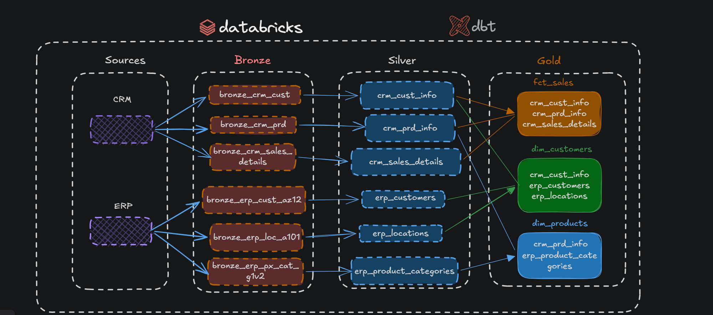

# Medallion Architecture (Bronze / Silver / Gold) in Databricks

## 1. Project Overview

This project implements a Medallion Data Architecture in Databricks using dbt. The goal is to ingest raw CRM and ERP data, rigorously clean and standardize it in the Silver layer, and build a unified analytical fact table in the Gold layer.

- **Source Systems:** CRM, ERP
- **Tools:** Databricks (Spark SQL), dbt
- **Architecture:** Bronze (Raw) -> Silver (Cleaned) -> Gold (Business Ready)

### 🗺️ Data Architecture & Lineage
The following diagram illustrates the complete data flow, including source systems, Bronze ingestion, Silver standardization, and the final Gold Star Schema.



### 💡 Tech Stack & Architecture Choices

- **OLTP vs. OLAP:** The reference tutorial uses **SQL Server** (OLTP), optimized for transactions and raw data. This project uses **Databricks** (OLAP), optimized for analytics and aggregations.
- **Schema Definition:** In the traditional SQL Server tutorial, explicit `CREATE TABLE` statements are required to define column data types and schemas. In this project using dbt, **manual DDL is not needed**. dbt automatically infers schemas and creates tables based on the `SELECT` logic.
- **Declarative Approach:** Instead of manually writing `DROP TABLE` and `INSERT INTO`, dbt handles table materialization, dependency ordering, and data lineage automatically.

### 🧐 Why SQL Server uses Stored Procedures (`CREATE OR ALTER PROCEDURE`)
In the reference tutorial, the author wraps the Silver layer transformations inside a Stored Procedure (`silver.load_silver`). This is a classic pattern in traditional data warehousing for several reasons:
1. **Batching & Orchestration:** A single procedure can execute all tables sequentially.
2. **Idempotency via Truncate-Load:** The procedure explicitly runs `TRUNCATE TABLE` followed by `INSERT INTO` to prevent duplicates.
3. **The dbt Alternative:** In modern data stacks using dbt, **Stored Procedures are no longer needed**. dbt acts as the orchestrator. By using `{{ ref() }}`, dbt automatically builds a DAG, handles execution order, and manages table truncation (via `materialized='table'`). It replaces the entire `CREATE PROCEDURE` logic with clean, modular SQL.

---

## 2. Data Profiling & Validation (Pre & Post-Cleaning Checks)

Before and after applying transformations, the data is profiled to identify anomalies.

### A. Check for Unwanted Spaces (`TRIM`)
```sql
SELECT prd_key, prd_nm
FROM crm_dbt_dev.bronze.bronze_crm_prd
WHERE prd_key != TRIM(prd_key) OR prd_nm != TRIM(prd_nm);
```

### B. Check for Duplicates (`HAVING COUNT > 1`)
```sql
SELECT prd_id, prd_key, COUNT(*) as duplicate_count
FROM crm_dbt_dev.bronze.bronze_crm_prd
GROUP BY prd_id, prd_key
HAVING COUNT(*) > 1;
```

### C. Check for Out-of-Range Dates (Birthdates)
```sql
SELECT DISTINCT bdate
FROM crm_dbt_dev.bronze.bronze_erp_cust_az12
WHERE bdate < '1924-01-01' OR bdate > current_date();
```

### D. Post-Cleaning Validations (on Silver Tables)
```sql
-- 1. Data Standardization (Product Line)
SELECT DISTINCT prd_line FROM crm_dbt_dev.silver.silver_crm_prd_info;

-- 2. Invalid Date Orders (SCD Overlap Check)
SELECT * FROM crm_dbt_dev.silver.silver_crm_prd_info WHERE prd_end_dt < prd_start_dt;

-- 3. Business Rules (Sales Amount Integrity)
SELECT * FROM crm_dbt_dev.silver.silver_crm_sales_details
WHERE sls_sales != sls_quantity * sls_price
   OR sls_sales IS NULL OR sls_quantity IS NULL OR sls_price IS NULL
   OR sls_sales <= 0 OR sls_price <= 0;
```

---

## 3. Data Cleaning Logic & Core Code (Silver Layer)

### A. Customer Tables (CRM + ERP)

#### ERP (`silver_erp_cust_az12.sql`)
```sql
{{ config(materialized='table', schema='silver', alias='erp_customers') }}
with
    source_data as (
        select * from {{ source('bronze_source', 'bronze_erp_cust_az12') }}
    )
select
    case 
        when cid like 'NAS%' then substring(cid, 4)
        else cid
    end as cid,
    case 
        when bdate < '1924-01-01' or bdate > current_date() then null 
        else bdate 
    end as bdate,
    case 
        when upper(trim(gen)) in ('M', 'MALE') then 'Male'
        when upper(trim(gen)) in ('F', 'FEMALE') then 'Female'
        else 'n/a'
    end as gen,
    current_timestamp() as dwh_create_date
from source_data;
```

#### CRM (`silver_crm_cust_info.sql`)
```sql
{{ config(materialized='table', schema='silver', alias='crm_cust_info') }}
with
    source_data as (
        select * from {{ source('bronze_source', 'bronze_crm_cust') }}
    ),
    filtered_data as (select * from source_data where cst_id is not null),
    deduplicated as (
        select *, row_number() over (partition by cst_id order by cst_create_date desc) as rn
        from filtered_data
    )
select
    cst_id,
    trim(cst_key) as cst_key,
    trim(cst_firstname) as cst_firstname,
    trim(cst_lastname) as cst_lastname,
    case
        when upper(trim(cst_marital_status)) = 'M' then 'Married'
        when upper(trim(cst_marital_status)) = 'S' then 'Single'
        else 'n/a'
    end as cst_marital_status,
    case
        when upper(trim(cst_gndr)) = 'M' then 'Male'
        when upper(trim(cst_gndr)) = 'F' then 'Female'
        else 'n/a'
    end as cst_gndr,
    current_timestamp() as dwh_create_date
from deduplicated
where rn = 1;
```

#### ERP (`silver_erp_loc_a101.sql`)
```sql
{{ config(materialized='table', schema='silver', alias='erp_locations') }}
with
    source_data as (
        select * from {{ source('bronze_source', 'bronze_erp_loc_a101') }}
    )
select
    replace(trim(cid), '-', '') as cid,
    case 
        when upper(trim(cntry)) in ('US', 'USA', 'UNITED STATES') then 'United States'
        when upper(trim(cntry)) in ('DE', 'GERMANY') then 'Germany'
        when upper(trim(cntry)) = 'AUSTRALIA' then 'Australia'
        when upper(trim(cntry)) = 'CANADA' then 'Canada'
        when upper(trim(cntry)) = 'UNITED KINGDOM' then 'United Kingdom'
        when upper(trim(cntry)) = 'FRANCE' then 'France'
        when trim(cntry) = '' or cntry is null then 'n/a'
        else upper(trim(cntry))
    end as cntry,
    current_timestamp() as dwh_create_date
from source_data;
```

### B. Product Tables (CRM + ERP)

#### CRM (`silver_crm_prd_info.sql`)
This model handles SCD Type 2 logic, fixing overlapping dates without losing history.

```sql
{{ config(materialized='table', schema='silver', alias='crm_prd_info') }}
with
    source_data as (select * from {{ source('bronze_source', 'bronze_crm_prd') }}),
    step1_base as (
        select
            prd_id,
            trim(prd_key) as prd_key,
            trim(prd_nm) as prd_nm,
            coalesce(prd_cost, 0) as prd_cost,
            case
                upper(trim(prd_line))
                when 'M' then 'Mountain'
                when 'R' then 'Road'
                when 'S' then 'Other Sales'
                when 'T' then 'Touring'
                else 'n/a'
            end as prd_line,
            replace(substring(prd_key, 1, 5), '-', '_') as cat_id,
            substring(trim(prd_key), 7) as sls_prd_key,
            prd_start_dt as orig_start_dt,
            prd_end_dt as orig_end_dt,
            prd_start_dt as fixed_start_dt,
            current_timestamp() as dwh_create_date
        from source_data
    ),
    step2_rebuild_timeline as (
        select
            prd_id, prd_key, prd_nm, prd_cost, prd_line, cat_id, sls_prd_key,
            orig_start_dt, orig_end_dt, dwh_create_date,
            fixed_start_dt as prd_start_dt,
            case
                when lead(fixed_start_dt) over (partition by prd_key order by fixed_start_dt, prd_id) is not null
                then date_sub(lead(fixed_start_dt) over (partition by prd_key order by fixed_start_dt, prd_id), 1)
                else null
            end as prd_end_dt
        from step1_base
    )
select * from step2_rebuild_timeline;
```

**Result Validation:**
The following image shows the successful execution in Databricks. You can clearly see how the overlapping historical dates (`orig_start_dt` / `orig_end_dt`) have been perfectly aligned into a clean timeline (`prd_start_dt` / `prd_end_dt`) without any gaps or overlaps.


#### ERP (`silver_erp_px_cat_g1v2.sql`)
```sql
{{ config(materialized='table', schema='silver', alias='erp_product_categories') }}
with
    source_data as (
        select * from {{ source('bronze_source', 'bronze_erp_px_cat_g1v2') }}
    )
select
    trim(id) as id,
    trim(cat) as cat,
    trim(subcat) as subcat,
    trim(maintenance) as maintenance,
    current_timestamp() as dwh_create_date
from source_data;
```

### C. Sales Table (`silver_crm_sales_details.sql`)
```sql
{{ config(materialized='table', schema='silver', alias='crm_sales_details') }}
with
    source_data as (select * from {{ source('bronze_source', 'bronze_crm_sales_details') }}),
    filtered_data as (select * from source_data where sls_ord_num is not null),
    cleaned_data as (
        select
            trim(sls_ord_num) as sls_ord_num,
            trim(sls_prd_key) as sls_prd_key,
            sls_cust_id,
            case 
                when sls_order_dt = 0 or length(cast(sls_order_dt as string)) != 8 then null
                else to_date(cast(sls_order_dt as string), 'yyyyMMdd')
            end as sls_order_dt,
            case 
                when sls_ship_dt = 0 or length(cast(sls_ship_dt as string)) != 8 then null
                else to_date(cast(sls_ship_dt as string), 'yyyyMMdd')
            end as sls_ship_dt,
            case 
                when sls_due_dt = 0 or length(cast(sls_due_dt as string)) != 8 then null
                else to_date(cast(sls_due_dt as string), 'yyyyMMdd')
            end as sls_due_dt,
            case
                when sls_sales is null or sls_sales <= 0 or sls_sales != sls_quantity * abs(sls_price) 
                then sls_quantity * abs(sls_price)
                else sls_sales
            end as sls_sales,
            sls_quantity,
            case
                when sls_price is null or sls_price <= 0 
                then sls_sales / nullif(sls_quantity, 0)
                else sls_price
            end as sls_price,
            current_timestamp() as dwh_create_date
        from filtered_data
    )
select * from cleaned_data;
```

---

## 4. dbt Project Structure & Tests

### A. Directory Structure
```text
crm_dbt/
├── assets/
│   ├── data_flow.png
│   └── cleaned crm prod.png
├── crm_dbt_in/
│   ├── analyses/
│   ├── dbt_packages/
│   ├── logs/
│   ├── macros/
│   ├── models/
│   │   ├── bronze/
│   │   │   └── sources.yml
│   │   ├── silver/
│   │   │   ├── schema.yml
│   │   │   ├── silver_crm_cust_info.sql
│   │   │   ├── silver_erp_cust_az12.sql
│   │   │   ├── silver_erp_loc_a101.sql
│   │   │   ├── silver_crm_prd_info.sql
│   │   │   ├── silver_erp_px_cat_g1v2.sql
│   │   │   └── silver_crm_sales_details.sql
│   │   └── gold/
│   │       └── fct_sales.sql
│   ├── seeds/
│   ├── snapshots/
│   ├── tests/
│   ├── dbt_project.yml
│   └── packages.yml
└── README.md
```

### B. Data Tests (`models/silver/schema.yml`)
```yaml
version: 2

models:
  - name: silver_crm_cust_info
    columns:
      - name: cst_id
        tests:
          - unique
          - not_null

  - name: silver_crm_sales_details
    columns:
      - name: sls_quantity
        tests:
          - dbt_utils.expression_is_true:
              expression: "> 0"
      - name: sls_sales
        tests:
          - not_null
          - dbt_utils.expression_is_true:
              expression: "> 0"
      - name: sls_price
        tests:
          - not_null
          - dbt_utils.expression_is_true:
              expression: "> 0"
```

---

## 5. How to Run

1. Install dbt packages:
   ```bash
   dbt deps
   ```
2. Run the Silver models:
   ```bash
   dbt run --select silver
   ```
3. Run the data quality tests:
   ```bash
   dbt test --select silver
   ```
4. Run the Gold models (once created):
   ```bash
   dbt run --select gold
   ```

---

## 6. Key Takeaways
- **Always Profile First:** Use `TRIM` checks, `HAVING COUNT > 1`, and date-range checks to find anomalies before writing cleaning logic.
- **dbt vs. Traditional SQL Server:** Unlike T-SQL where you manually write `CREATE TABLE` and `INSERT`, dbt uses a declarative `SELECT` approach. It automatically infers schemas, manages dependencies, and makes the code modular and version-controlled.
- **OLAP vs. OLTP:** The source systems are OLTP (optimized for transactions), while our Databricks Medallion architecture is OLAP (optimized for analytics and aggregations).
- **Deduplication:** Use `ROW_NUMBER()` partitioned by the primary key and ordered by timestamp.
- **SCD2 Timeline Repair:** Use `LEAD()` and `DATE_SUB()` to dynamically fix overlapping dates while preserving historical data.
- **Defensive Programming:** Use `NULLIF(column, 0)` when dividing to prevent fatal `Divide by Zero` errors. Handle extreme out-of-range dates (e.g., `9999-11-20`) by setting them to `NULL`.
- **Audit Trails:** Always keep the `orig_` columns for future debugging and data lineage.

---

## 7. Reference
- **SQL Data Warehouse Portfolio Project:** [YouTube Playlist](https://www.youtube.com/playlist?list=PLNcg_FV9n7qaUWeyUkPfiVtMbKlrfMqA8)